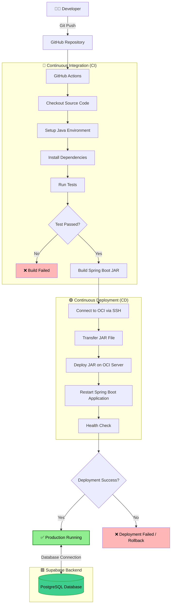

# 스마일 게이트 팔레트 커뮤니티 페이지

스마일 게이트 팔레트 커뮤니티 백엔드 설명 문서입니다.

**Domain: https://www.smilegate-palette.com/** 

## CI / CD

## Oracle Cloud - Supabase - GitHub Actions CI/CD Workflow

## CI/CD Architecture

## Technology Stack

| Component | Technology | Description |
|---|---|---|
| Source Control | GitHub | Source code management |
| CI/CD | GitHub Actions | Automated build and deployment |
| Backend | Spring Boot | Java backend application |
| Build Tool | Gradle  | Dependency management and JAR build |
| Cloud Server | Oracle Cloud Infrastructure (OCI) | Production server |
| Deployment | SSH | Secure JAR file transfer |
| Database | Supabase PostgreSQL | Cloud database |

## Deployment Process

1. Developer pushes code to GitHub.
2. GitHub Actions starts the CI pipeline.
3. Java environment and dependencies are configured.
4. Automated tests are executed.
5. Spring Boot application is packaged into a JAR
