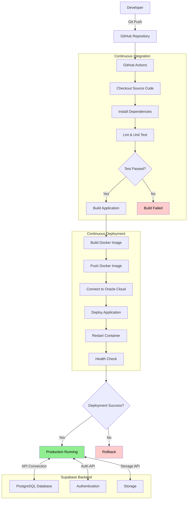
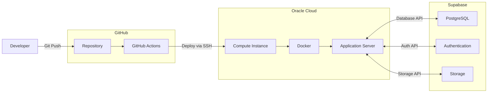
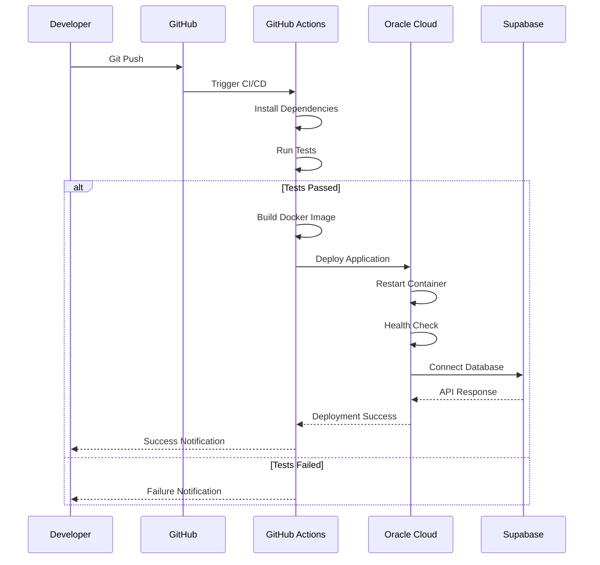

# 스마일 게이트 팔레트 커뮤니티 페이지

스마일 게이트 팔레트 커뮤니티 백엔드 설명 문서입니다.

## Tech stack
**language : JAVA Spring boot** 
**DB : supabase**
**language : JAVA Spring boot**  
**server : OCI (Oracle Cloud  Infrastructure)**  

## CI / CD

## Oracle Cloud - Supabase - GitHub Actions CI/CD Workflow

## 1. CI/CD Architecture Flowchart

## 2. Infrastructure Architecture

## 3. Deployment Process

